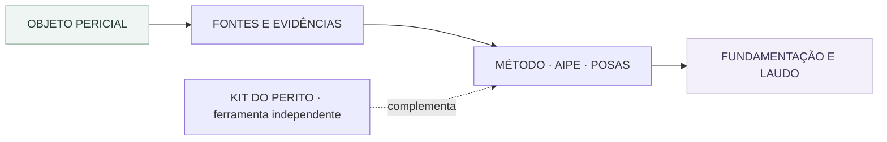

<div align="center">

# MedPer

### Método médico-pericial estruturado, rastreável e orientado ao objeto

[](https://joyceradis.github.io/MedPer/)
[](#estado-atual)
[](#arquitetura-atual)

**Plataforma de apoio à organização do raciocínio médico-pericial, das evidências e do documento técnico final.**

> O MedPer não substitui o juízo médico. O sistema estrutura informações, explicita o método, identifica lacunas e produz uma base documental rastreável. A análise, a valoração, a conclusão e a assinatura permanecem sob responsabilidade exclusiva da médica ou do médico perito.

</div>

---

## Runtime público atual · V2 (17/10/2026)

**A entrada pública `app.html` carrega `js/v2/app.js`, com 11 etapas e persistência local em IndexedDB (`medper-v2`) e fallback `localStorage`.** Esse runtime é diferente do frontend anterior baseado em `js/main.js` e `js/core/store.js`. O backend FastAPI/PostgreSQL e o schema Supabase presentes no repositório não estão conectados à persistência da V2 pública.

- [Como a V2 realmente funciona e quais são os limites de dados](docs/V2_RUNTIME.md)
- [Manual técnico da V2](README-V2.md) · [Critérios de aceitação](docs/medper-v2-acceptance.md)
- [Segurança](SECURITY.md) · [Roadmap atualizado](ROADMAP.md) · [Issue de coordenação #95](https://github.com/joyceradis/MedPer/issues/95)

**Não inserir dados reais de periciados, prontuários, fotografias clínicas ou autos sigilosos.** O armazenamento da V2 no dispositivo não tem criptografia aplicada pelo módulo atual. A presença de proteção no backend experimental não protege automaticamente este frontend.

### Componentes executados na entrada V2

| Função | Arquivo |
| --- | --- |
| Entrada e interface de 11 etapas | [`app.html`](app.html) · [`js/v2/app.js`](js/v2/app.js) |
| Modelo e versão do caso | [`js/v2/case-record.js`](js/v2/case-record.js) |
| IndexedDB e fallback local | [`js/v2/repository.js`](js/v2/repository.js) |
| Sugestão de instrumentos | [`js/v2/method-router.js`](js/v2/method-router.js) |
| Documento A4 | [`js/v2/document.js`](js/v2/document.js) |
| Instrumentos de referência | [`js/methodology/aipe.js`](js/methodology/aipe.js) · [`posas.js`](js/methodology/posas.js) |

Os demais módulos, testes e documentos históricos continuam versionados, mas não devem ser confundidos com dependências carregadas por `app.html`. **Migração integral de casos do frontend antigo para a V2 não está comprovada.**

---

## Identidade e limites do projeto

**Categoria:** software médico-pericial especializado · desenvolvimento independente.

O **MedPer** organiza o fluxo pericial completo, da definição do objeto à análise de evidências e ao documento técnico. O [Kit do Perito](https://github.com/joyceradis/pericia-medica) é um produto complementar de cálculos e instrumentos pontuais. Não são o mesmo software.

A Radis é um workspace pessoal diferente: pode oferecer um atalho para o MedPer **se isso for útil e decidido futuramente**, sem assumir seus dados, sua execução ou sua evolução. Não existe integração funcional comprovada entre ambos.

**Estado e limitações:** consultar [Estado atual](#estado-atual); protótipo público não equivale a aplicação pericial homologada.

**Rastreabilidade:** [histórico do README](https://github.com/joyceradis/MedPer/commits/main/README.md) · [PRs](https://github.com/joyceradis/MedPer/pulls?q=is%3Apr).

## Encontrar componentes existentes

| Necessidade | Onde está |
|---|---|
| Mapa de páginas e fluxo pericial | [`docs/SITE_MAP.md`](docs/SITE_MAP.md) · [`pages/`](pages/) |
| Estados e ciclo de vida do caso | [`js/core/case-lifecycle.js`](js/core/case-lifecycle.js) |
| AIPE, POSAS e danos temporários | [`js/methodology/aipe.js`](js/methodology/aipe.js) · [`posas.js`](js/methodology/posas.js) · [`temporary-damages.js`](js/methodology/temporary-damages.js) |
| Seleção metodológica e integração pericial | [`js/methodology/engine.js`](js/methodology/engine.js) · [`pericial-integration.js`](js/methodology/pericial-integration.js) |
| Contratos, status e testes | [`docs/ARCHITECTURE.md`](docs/ARCHITECTURE.md) · [`docs/STATUS.md`](docs/STATUS.md) · [`tests/`](tests/) |

**Fronteira:** o [Kit do Perito](https://github.com/joyceradis/pericia-medica) é uma ferramenta avulsa complementar. Nenhuma dessas funcionalidades deve ser reimplementada em outro produto sem comparação das regras e necessidades.

### Diagrama de orientação · Workflow pericial



**Leitura:** setas contínuas representam o fluxo conceitual dentro do produto; setas pontilhadas indicam relação entre sistemas ou possibilidade futura, **não integração implementada**.

## Visão do produto

A perícia médica não começa pelo laudo. Começa pela compreensão da missão pericial.

O MedPer foi concebido para conduzir o trabalho na sequência em que um raciocínio técnico consistente deve ocorrer:

```text
Contexto e esfera
        ↓
Delimitação do objeto
        ↓
Autos, fontes e fatos
        ↓
Cronologia
        ↓
Hipóteses e diligências
        ↓
Exame e método aplicável
        ↓
Fundamentação técnico-científica
        ↓
Conclusão proporcional à prova
        ↓
Quesitos
        ↓
Documento final
```

O produto busca reduzir três riscos recorrentes:

1. começar a escrever antes de delimitar o objeto;
2. misturar fato, hipótese, interpretação e conclusão;
3. formular conclusões sem explicitar as evidências, limitações e o grau de sustentação.

---

## Princípios invariantes

- **Objeto antes do protocolo:** a matéria e o contexto determinam a metodologia aplicável.
- **Fatos antes de conclusões:** documentos, eventos, observações e achados permanecem separados da interpretação.
- **Nenhuma conclusão sem sustentação:** bloqueios e ressalvas metodológicas devem ser visíveis.
- **Proporcionalidade epistêmica:** a linguagem da conclusão deve refletir a suficiência real dos elementos disponíveis.
- **Rastreabilidade:** o documento final deve derivar do estado estruturado do caso.
- **Metodologias contextualizadas:** AIPE é aplicada somente ao dano estético; outros objetos utilizam protocolos próprios.
- **IA assistiva, nunca decisória:** recursos futuros de IA poderão organizar e revisar, mas não valorar dano, afirmar nexo ou substituir exame.
- **Validação humana obrigatória:** nenhuma saída é considerada laudo ou parecer válido sem revisão e assinatura profissional.

---

## Estado atual

O MedPer permanece **protótipo técnico, não homologado para dados reais**. É importante distinguir as funcionalidades da V2 efetivamente carregada das implementações antigas que ainda existem no repositório.

**V2 executada por `app.html`:** criação e edição local de casos, 11 etapas de workspace, fontes, cronologia, história e exame, instrumentos contextuais, matriz de evidências, quesitos, conclusão redigida pela perita, exportação/importação de JSON V2 e composição de documento A4. Isso descreve capacidades presentes no código, **não certificação de comportamento integral em todos os navegadores**.

**Persistência:** IndexedDB `medper-v2`, fallback `medper:v2:cases` no navegador. Não existe sincronização automática com FastAPI ou Supabase. Casos históricos requerem migração validada antes de qualquer conversão.

**Pendências antes de dados reais:** segurança e isolamento, criptografia apropriada, retenção e recuperação, testes reais do navegador, contrato versionado de caso e backend canônico. O armazenamento local não oferece essas garantias.

Veja o estado verificável em [`docs/V2_RUNTIME.md`](docs/V2_RUNTIME.md) e a fila executável em [`ROADMAP.md`](ROADMAP.md).

---

## Acessos

| Ambiente | Endereço | Finalidade |
|---|---|---|
| Site público | [`/MedPer/`](https://joyceradis.github.io/MedPer/) | apresentação institucional do produto |
| Aplicação | [`/MedPer/app.html`](https://joyceradis.github.io/MedPer/app.html) | protótipo operacional e modo local |
| Roadmap | [`ROADMAP.md`](./ROADMAP.md) | fonte de verdade das etapas do produto |
| Método | [`docs/MEDPER_METHOD.md`](./docs/MEDPER_METHOD.md) | especificação cognitiva e metodológica |
| Auditoria | [`docs/AUDIT_REGRESSION.md`](./docs/AUDIT_REGRESSION.md) | baseline e gates de regressão |

---

## Arquitetura atual · entrada V2

```text
index.html              apresentação
app.html                entrada do aplicativo
  └── js/v2/app.js      interface, fluxo de 11 etapas e interações
      ├── case-record.js    schemaVersion 2 e normalização
      ├── repository.js     IndexedDB + fallback localStorage
      ├── method-router.js  sugestões contextuais
      └── document.js       estrutura A4 para impressão
sw.js                   cache estático do shell
backend/                serviço FastAPI em desenvolvimento, não ligado à V2
supabase/               proposta histórica concorrente, não ligada à V2
```

O código de `js/main.js`, `js/core/store.js` e `js/ui/**` conserva regras, testes e documentação da arquitetura anterior; não é iniciado pelo `app.html` V2. As invariantes médico-periciais continuam válidas, mas seu funcionamento precisa ser comprovado no runtime efetivo.

**Dado local ≠ dado protegido por backend.** Não realizar migração destrutiva, apagar dados ou presumir isolamento. Mais detalhes em [`docs/V2_RUNTIME.md`](docs/V2_RUNTIME.md).

---

## Executar localmente

O projeto não exige build para a versão atual. Como utiliza módulos ES, deve ser servido por HTTP.

### Python

```bash
python3 -m http.server 8080
```

Acesse:

```text
http://localhost:8080/
http://localhost:8080/app.html
```

### Node.js

```bash
npx serve .
```

Não abra os arquivos diretamente com `file://`, pois imports ES, Service Worker e algumas APIs do navegador dependem de um contexto HTTP válido.

---

## Verificação técnica

### Sintaxe dos módulos

```bash
npm run check
```

A cadeia canônica de módulos verificados vive em `package.json`, no script `check`. Ela não é replicada aqui de propósito: uma lista copiada envelhece em silêncio, e a divergência entre documentação e código é exatamente o defeito que este projeto trata como bloqueio.

### Testes de regressão

```bash
npm test          # suíte completa
npm run audit     # check + test, a cadeia usada pela CI
```

As suítes cobrem persistência e migração de casos legados, metodologia contextual, protocolos e AIPE, superfícies do dashboard, camada de conhecimento, marca e âncora visual, fronteira do legado MLKS, e o runtime dos workflows do GitHub Actions.

A lista executável está em `package.json`, no script `test`. Um teste que existe no arquivo mas não está na cadeia não roda — e esse foi um defeito real encontrado neste repositório, por isso a cadeia é a fonte, não esta seção.

---

## Metodologia médico-pericial

O núcleo metodológico é composto por duas camadas.

### Método geral

Aplicável a todos os objetos:

1. delimitação;
2. material analisado;
3. execução técnica;
4. avaliação de consistência;
5. hipóteses e alternativas;
6. limitações;
7. grau de sustentação;
8. conclusão admissível.

### Protocolos específicos

| Matéria | Foco do protocolo |
|---|---|
| Dano estético | consolidação, descrição morfológica, percepção, fotografia, AIPE e fundamentação |
| Incapacidade | diagnóstico, déficit funcional, atividade habitual, capacidade residual e temporalidade |
| Nexo causal e concausa | evento, compatibilidade temporal/anatômica, plausibilidade, estado anterior e alternativas |
| Responsabilidade profissional | contexto assistencial, indicação, execução, acompanhamento, dano e nexo |
| Outras matérias | protocolo genérico estruturado, até existir módulo específico validado |

A documentação integral está em [`docs/MEDPER_METHOD.md`](./docs/MEDPER_METHOD.md).

---

## Persistência remota · decisão pendente

Há implementações experimentais de FastAPI/PostgreSQL em `backend/` e modelo Supabase em `supabase/`. **Nenhuma é a persistência operacional do frontend público V2**. A escolha de um backend único, modelo de autorização, migração, sincronização offline, backup e retenção está em revisão nas issues [#68](https://github.com/joyceradis/MedPer/issues/68), [#69](https://github.com/joyceradis/MedPer/issues/69) e [#95](https://github.com/joyceradis/MedPer/issues/95).

Não usar exemplos de schema futuro como prova de implementação.

---

## Segurança e privacidade

Antes de produção, são obrigatórios:

- autenticação real;
- confirmação e recuperação de conta;
- segregação por usuário e organização;
- Row-Level Security testada com múltiplas identidades;
- criptografia em trânsito e em repouso;
- armazenamento seguro de documentos;
- trilha de auditoria;
- política de retenção e exclusão;
- backup e restauração testados;
- monitoramento e resposta a incidentes;
- termos de uso, política de privacidade e definição dos papéis de tratamento de dados.

Nunca devem ser incluídas no frontend:

- `service_role` do Supabase;
- chaves privadas de provedores;
- segredos de cobrança;
- credenciais de serviços de IA.

---

## Roadmap oficial

O plano deve começar pela integridade e segurança da V2, e não pela conexão prematura a um serviço de dados. Consulte [`ROADMAP.md`](ROADMAP.md) para prioridades, dependências e critérios verificáveis.

---

## Governança de mudanças

Nenhuma alteração estrutural deve ser considerada concluída sem:

1. escopo declarado;
2. preservação dos dados legados;
3. teste de regressão;
4. revisão do impacto metodológico;
5. validação manual da experiência afetada;
6. atualização da documentação correspondente.

Mudanças de interface, autenticação, persistência remota e cobrança não devem ser misturadas no mesmo conjunto de commits.

---

## Autoria e responsabilidade técnica do produto

O MedPer é idealizado e dirigido por **Dra. Joyce Radis de Souza de Oliveira — CRM-ES 21188**, médica e perita judicial.

O projeto encontra-se em desenvolvimento privado de produto, embora o protótipo técnico esteja publicado em repositório aberto. A presença do código no GitHub não representa autorização para uso clínico, pericial, comercial ou institucional sem validação própria e observância das normas aplicáveis.

---

<div align="center">

**MedPer — o método antes do documento.**

</div>
